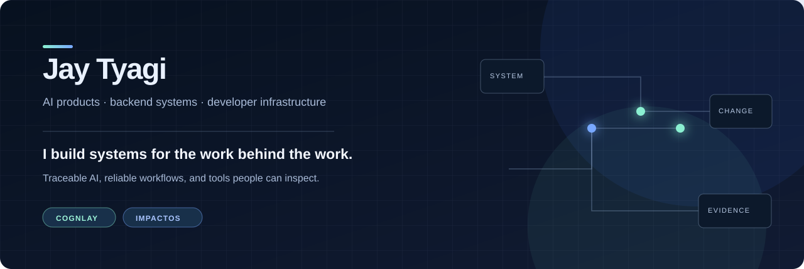

  

  
  
  

## Building useful systems

I am a founder and engineer working on AI-native products, dependable backend services, and developer tooling. I care about systems that explain their output, make failure visible, and stay useful after the demo.

| Featured project | Focus |
| :--- | :--- |
| [**ImpactOS**](https://github.com/jaytyagiwithai-wq/ImpactOS) | Traceable change-impact investigations for engineering teams. Next.js · FastAPI · PostgreSQL · pgvector · OpenTelemetry |
| [**DispatchFlow**](https://github.com/jaytyagiwithai-wq/DispatchFlow) | Multi-tenant order dispatch with transactional messaging, idempotency, retries, and reconciliation. |
| [**otel-inv**](https://github.com/jaytyagiwithai-wq/otel-inv) | An observability lab for FastAPI with traces, structured logs, ClickHouse, Grafana, and load testing. |
| [**ToolDock**](https://github.com/jaytyagiwithai-wq/tooldock_2.0) | Turn a typed Python function into a CLI, REST API, MCP tool, and live tool studio. |

## Toolkit

`Python` · `TypeScript` · `FastAPI` · `Next.js` · `PostgreSQL` · `Docker` · `OpenTelemetry` · `LangGraph` · `LLM systems`

Currently building <a href="https://cognlay.com">Cognlay</a> and exploring reliable multi-agent systems.

